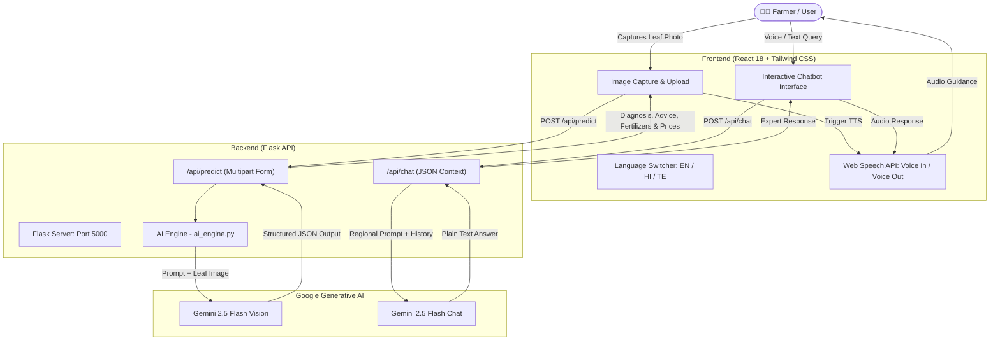

# 🌾 Savishkar — Smart Kisan Assistant
> **AI-Powered Multilingual Crop Disease Diagnosis & Agricultural Advisory Platform**

[](https://react.dev/)
[](https://flask.palletsprojects.com/)
[](https://tailwindcss.com/)
[](https://ai.google.dev/)
[](https://www.python.org/)

---

## 📖 Overview

**Savishkar (Smart Kisan Assistant)** is an AI-driven agricultural assistant built to empower farmers with instant, accessible crop diagnostics and treatment advice. By combining state-of-the-art vision models (**Gemini 2.5 Flash**) with regional language localization and voice capabilities, Savishkar bridges the gap between scientific agricultural research and ground-level farming.

Farmers can snap or upload a photo of an unhealthy plant leaf to receive:
1. **Accurate Disease Identification**: Instant diagnosis of the disease affecting the crop.
2. **Visual Observation**: Concise summary of symptoms and anomalies detected on the leaf.
3. **Actionable Treatment Plans**: Practical measures to mitigate crop damage.
4. **Local Fertilizer & Medicine Recommendations**: Tailored commercial and organic solutions with estimated prices in Indian Rupees (₹).
5. **Interactive Agricultural Scientist Chatbot**: A multilingual voice-enabled assistant to answer follow-up queries.

---

## ✨ Key Features

- 🌿 **Visual Disease Detection**: Upload or capture leaf photos to diagnose health issues using multimodal Gemini Vision.
- 🌐 **Multilingual Support**: Real-time localization across three languages:
  - **English**
  - **Hindi (हिंदी)**
  - **Telugu (తెలుగు)**
- 🔊 **Text-to-Speech (Audio Readout)**: Tap the speaker icon to listen to diagnoses, observations, and fertilizer costs in the selected regional accent (`en-IN`, `hi-IN`, `te-IN`).
- 🎤 **Voice-Activated Chatbot ("Ask Expert")**: Speak questions directly using the Web Speech API; the AI expert responds with concise agricultural advice and reads it aloud.
- 💡 **Context-Aware Follow-ups**: The chatbot automatically recognizes previously scanned crop diseases to provide tailored guidance.
- 📱 **Mobile-First & Responsive**: Built with Tailwind CSS for seamless operation across smartphones, tablets, and desktops.

---

## 🏗️ System Architecture



---

## 📂 Project Structure

```text
Savishkar/
├── backend/
│   ├── dataset/             # Training datasets and crop imagery
│   ├── uploads/             # Temporary storage for uploaded leaves
│   ├── .env.example         # Template for environment variables
│   ├── ai_engine.py         # Gemini multimodal image analysis engine
│   ├── app.py               # Flask REST API endpoints (/api/predict, /api/chat)
│   ├── create_dummy_model.py# Utility to generate starter TensorFlow models
│   ├── train_model.py       # MobileNetV2 transfer learning training pipeline
│   └── requirements.txt     # Python backend dependencies
├── frontend/
│   ├── public/              # Static HTML shell and assets
│   ├── src/
│   │   ├── App.js           # Main application view, scanner card, and result panels
│   │   ├── Chatbot.js       # Voice-enabled conversational agri-scientist widget
│   │   ├── i18n.js          # Multilingual dictionary (EN, HI, TE)
│   │   ├── index.css        # Tailwind CSS imports and utility styles
│   │   └── index.js         # React entry point
│   ├── package.json         # Frontend dependencies and scripts
│   ├── postcss.config.js    # PostCSS plugins for Tailwind
│   └── tailwind.config.js   # Tailwind design tokens
├── .gitignore               # Ignored files (node_modules, .env, build, uploads)
├── package.json             # Root monorepo orchestration (concurrently)
├── vercel.json              # Vercel deployment and API rewrite configuration
└── README.md                # Project documentation
```

---

## 🚀 Getting Started

### Prerequisites

Ensure you have the following installed on your machine:
- **Node.js**: v16.x or higher ([Download Node.js](https://nodejs.org/))
- **Python**: v3.10 or higher ([Download Python](https://www.python.org/))
- **Google Gemini API Key**: Obtain a free API key from [Google AI Studio](https://aistudio.google.com/)

---

### 1. Clone the Repository

```bash
git clone https://github.com/manohar-munna/Savishkar.git
cd Savishkar
```

---

### 2. Configure Environment Variables

Create a `.env` file in the `backend/` folder:

```bash
# In backend/.env
GEMINI_API_KEY=your_gemini_api_key_here
```

*(You can copy `backend/.env.example` as a starting template)*

---

### 3. Installation

You can install all dependencies for both frontend and backend using the root helper script:

```bash
npm run install-all
```

*Or install them individually:*

**Backend:**
```bash
cd backend
pip install -r requirements.txt
cd ..
```

**Frontend:**
```bash
cd frontend
npm install
cd ..
```

---

### 4. Running the Application

#### Option A: Run Both Concurrently (Recommended)
From the repository root directory:
```bash
npm start
```
This starts both the Flask API server (`http://127.0.0.1:5000`) and the React development server (`http://localhost:3000`) simultaneously.

#### Option B: Run Separately

**Start the Flask Backend:**
```bash
cd backend
python app.py
```
*Backend runs at `http://127.0.0.1:5000`*

**Start the React Frontend:**
```bash
cd frontend
npm start
```
*Frontend runs at `http://localhost:3000` (proxied to port 5000 for `/api` calls)*

---

## 📡 API Reference

### 1. Crop Disease Prediction

- **Endpoint**: `POST /api/predict`
- **Content-Type**: `multipart/form-data`
- **Parameters**:
  - `image`: File (Leaf/Crop image)
  - `language`: String (`en`, `hi`, `te`)
- **Response Format**:
  ```json
  {
    "observation": "Yellow spots visible along the outer edges of the leaf.",
    "disease": "Tomato - Early Blight",
    "suggestions": "Prune affected lower leaves. Apply copper-based fungicide every 7-10 days.",
    "fertilizers": [
      { "name": "Mancozeb 75% WP", "price": "₹280" },
      { "name": "Copper Oxychloride", "price": "₹350" }
    ],
    "confidence": 92.5
  }
  ```

---

### 2. Agricultural Chatbot

- **Endpoint**: `POST /api/chat`
- **Content-Type**: `application/json`
- **Payload**:
  ```json
  {
    "question": "How often should I water during flowering?",
    "language": "hi",
    "history": [
      { "sender": "user", "text": "What fertilizer is best?" },
      { "sender": "bot", "text": "Use balanced NPK 19:19:19." }
    ],
    "disease_context": "Tomato - Early Blight"
  }
  ```
- **Response Format**:
  ```json
  {
    "reply": "फूल आने के दौरान मिट्टी में नमी बनाए रखें, लेकिन अत्यधिक पानी से बचें। सप्ताह में 2-3 बार आवश्यकतानुसार सिंचाई करें।"
  }
  ```

---

## 🛠️ Tech Stack

| Layer | Technologies |
|---|---|
| **Frontend** | React 18, Tailwind CSS, Axios, Lucide Icons |
| **Audio & Speech** | Web Speech API (`SpeechRecognition`, `SpeechSynthesis`) |
| **Backend** | Python, Flask, Flask-CORS, Werkzeug, python-dotenv |
| **AI / Machine Learning** | Google Gemini 2.5 Flash Vision & Chat (`google-generativeai`), Pillow |
| **Deployment / Scripts** | Concurrently, Vercel (`vercel.json`) |

---

## 🗺️ Roadmap & Future Enhancements

- [ ] **Offline Inference**: On-device lightweight TensorFlow Lite / ONNX model execution for zero-connectivity farm zones.
- [ ] **Weather & Mandi Integration**: Dynamic weather alerts and real-time local mandi commodity crop pricing.
- [ ] **Soil Health Analysis**: Soil testing card scanning with customized N-P-K recommendation curves.
- [ ] **Automated WhatsApp Advisory**: Delivery of daily tips and alerts directly to farmers via WhatsApp Business API.

---

## 📄 License

This project is open-source and available under the [MIT License](LICENSE).
